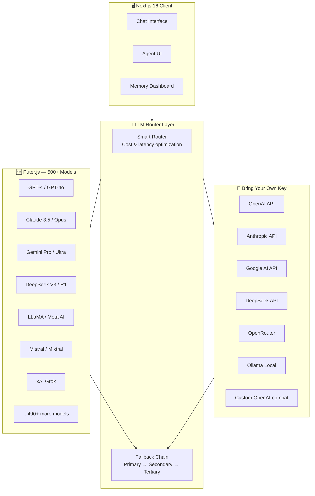
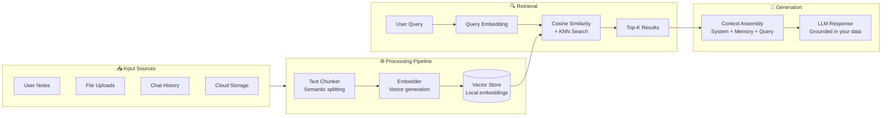
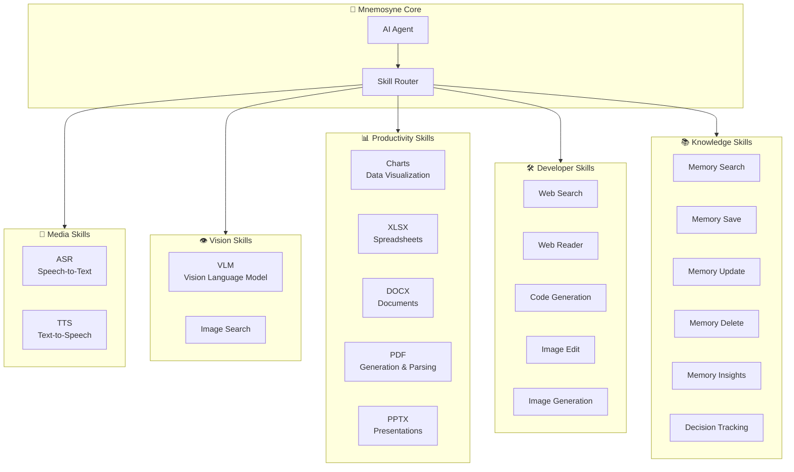
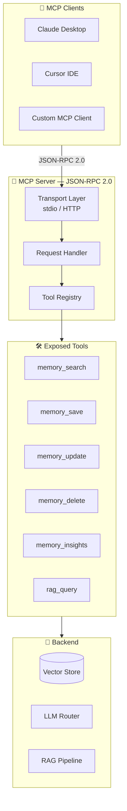
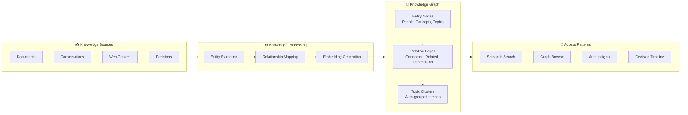

<a href="https://github.com/mulkymalikuldhrs/mnemosyne">
  
</a>

<div align="center">

[](https://git.io/typing-svg)

<br/>

[](https://nextjs.org/)
[](https://www.typescriptlang.org/)
[](https://puter.com/)
[](https://modelcontextprotocol.io/)
[](https://web.dev/progressive-web-apps/)
[](https://github.com/mulkymalikuldhrs/mnemosyne/releases)
[](LICENSE)

<br/>

[](https://github.com/mulkymalikuldhrs/mnemosyne/stargazers)
[](https://github.com/mulkymalikuldhrs/mnemosyne/fork)
[](https://github.com/mulkymalikuldhrs/mnemosyne/issues)

</div>

---

## 📖 Overview

**Mnemosyne** is a free multi-LLM hub with 500+ models and an AI Agent Memory Center built with Next.js 16. It provides access to hundreds of AI models through Puter.js — no API keys required — alongside BYOK (Bring Your Own Key) support for every major provider. The built-in AI Agent ships with 7 tools, semantic memory powered by local vector embeddings, RAG (Retrieval-Augmented Generation), an MCP server for integration with Claude Desktop and Cursor, and multi-cloud storage across 5 providers.

No backend server is needed. Puter.js handles authentication and billing on the client side (user-pays model), so you can access models like GPT-4, Claude, and Gemini without managing infrastructure.

> **What "Free" Means Here**: You don't need your own API keys to use models — Puter.js uses a user-pays model where Puter handles the billing. Usage is subject to Puter.js rate limits and fair use policies.

---

## ✨ Features

| # | Feature | Description |
|---|---------|-------------|
| 1 | **500+ Models via Puter.js** | Access GPT-4, Claude, Gemini, DeepSeek, xAI, Meta, Mistral and more — zero API keys needed |
| 2 | **BYOK Support** | Bring your own API keys for OpenAI, Anthropic, Google, DeepSeek, OpenRouter, Ollama, or any OpenAI-compatible endpoint |
| 3 | **AI Agent + 7 Tools** | Built-in agent with memory search, save, update, delete, insights, web search, and decision tracking |
| 4 | **Semantic Memory** | Vector-embedded notes with automatic chunking, embedding generation, and intelligent similarity retrieval |
| 5 | **MCP Server** | JSON-RPC 2.0 server for Claude Desktop, Cursor, and any MCP-compatible client integration |
| 6 | **RAG Pipeline** | Retrieval-Augmented Generation injects relevant memories into LLM conversations for contextual responses |
| 7 | **Multi-Cloud Storage** | Google Drive, TeraBox, S3, Puter.js FS, and local storage with file ingestion into memory |
| 8 | **PWA Installable** | Works as a Progressive Web App — install on desktop or mobile for native-like experience |
| 9 | **No Backend Required** | Fully client-side with Puter.js — deploy as a static Next.js app, no server to manage |

---

## 🏗️ Architecture

```
┌─────────────────────────────────────────────────────────────────┐
│                        MNEMOSYNE v2.0                          │
│                    Next.js 16 Application                       │
├─────────────────────────────────────────────────────────────────┤
│                                                                 │
│  ┌──────────────┐  ┌──────────────┐  ┌──────────────────────┐  │
│  │   Chat UI    │  │  Agent UI    │  │   Memory Dashboard   │  │
│  │  (React/Next)│  │  (7 Tools)   │  │  (CRUD + Search)     │  │
│  └──────┬───────┘  └──────┬───────┘  └──────────┬───────────┘  │
│         │                 │                      │              │
│         ▼                 ▼                      ▼              │
│  ┌─────────────────────────────────────────────────────────┐   │
│  │                    LLM Router Layer                      │   │
│  │  ┌─────────────┐                ┌─────────────────────┐ │   │
│  │  │  Puter.js   │                │     BYOK Keys        │ │   │
│  │  │ (500+ models│                │ (OpenAI/Anthropic/   │ │   │
│  │  │  no API key)│                │  Google/DeepSeek/    │ │   │
│  │  └─────────────┘                │  Ollama/OpenRouter)  │ │   │
│  │                                  └─────────────────────┘ │   │
│  └─────────────────────────────────────────────────────────┘   │
│                          │                                      │
│         ┌────────────────┼────────────────┐                    │
│         ▼                ▼                ▼                    │
│  ┌─────────────┐ ┌──────────────┐ ┌───────────────┐          │
│  │   RAG       │ │   Semantic   │ │  MCP Server   │          │
│  │  Pipeline   │ │   Memory     │ │ (JSON-RPC 2.0)│          │
│  │             │ │  (Vectors)   │ │               │          │
│  │ Memory →    │ │ Embed → Chunk│ │ Claude Desktop│          │
│  │ Context →   │ │ → Similarity │ │ Cursor IDE    │          │
│  │ LLM Prompt  │ │  Retrieval   │ │ MCP Clients   │          │
│  └─────────────┘ └──────────────┘ └───────────────┘          │
│                          │                                      │
│         ┌────────────────┼────────────────┐                    │
│         ▼                ▼                ▼                    │
│  ┌───────────┐   ┌────────────┐   ┌────────────┐             │
│  │Google Drive│   │  TeraBox   │   │  S3 / R2   │             │
│  └───────────┘   └────────────┘   └────────────┘             │
│  ┌───────────┐   ┌────────────┐                               │
│  │ Puter.js  │   │   Local    │   Multi-Cloud Storage          │
│  │    FS     │   │  Storage   │   (File Ingestion)             │
│  └───────────┘   └────────────┘                               │
│                                                                 │
└─────────────────────────────────────────────────────────────────┘
```

---

## 🗺️ Visual Architecture

> Interactive Mermaid diagrams — viewable on GitHub. These illustrate the system design, data flow, and integrations at a glance.

### Multi-LLM Hub Architecture



### RAG Memory Pipeline



### Skills Plugin System



### MCP Server Architecture



### Knowledge Graph Flow



## ⚠️ Honest Notes

> We believe in transparency. Here are important limitations and clarifications.

| Topic | Clarification |
|-------|--------------|
| **"Free" models** | Puter.js uses a user-pays model — you don't need API keys, but Puter handles billing. Usage is subject to rate limits and fair use policies. |
| **500+ model count** | Includes all models available through Puter.js. The exact count may vary over time as models are added or removed. |
| **Semantic Memory** | Uses **local vector storage** in the browser/client — it is not as powerful as dedicated vector databases (Pinecone, Weaviate, etc.) for large-scale datasets. Best suited for personal knowledge management. |
| **MCP Server** | Requires a compatible MCP client (Claude Desktop, Cursor, etc.) to connect. The MCP server is a standalone JSON-RPC process. |
| **No Backend** | Core features work without a backend. Self-hosted deployment still requires a Node.js runtime to serve the Next.js app. |
| **Model Availability** | Depends on Puter.js and may change without notice. Some models may have reduced rate limits. |

---

## 🚀 Quick Start

### Prerequisites

- **Node.js** 18+ and **npm** 9+
- A modern browser (Chrome, Firefox, Edge, Safari)
- (Optional) API keys for BYOK providers

### Installation

```bash
# Clone the repository

<!-- AUTO-PACKAGE-BADGES:START -->
<!-- Auto-generated package badges -->

   [](https://www.npmjs.com/package/@mnemosyne/memory)

<!-- AUTO-PACKAGE-BADGES:END -->
git clone https://github.com/mulkymalikuldhrs/mnemosyne.git
cd mnemosyne

# Install dependencies
npm install

# Configure environment
cp .env.example .env
# Edit .env with your optional BYOK keys

# Start development server
npm run dev
```

Open [http://localhost:3000](http://localhost:3000) — you're ready to chat with 500+ models.

### Production Build

```bash
npm run build
npm start
```

### Docker (Optional)

```bash
docker build -t mnemosyne .
docker run -p 3000:3000 mnemosyne
```

---

## 🤖 AI Agent — 7 Built-in Tools

Mnemosyne includes an AI Agent that can autonomously interact with your knowledge base and the web. The agent has 7 tools:

### Tool Reference

| # | Tool | Description | Example Use |
|---|------|-------------|-------------|
| 1 | **Memory Search** | Search semantic memory using natural language queries with vector similarity | *"Find notes about machine learning architectures"* |
| 2 | **Memory Save** | Save new information to semantic memory with automatic chunking and embedding | *"Save: Transformers use self-attention mechanisms"* |
| 3 | **Memory Update** | Update existing memory entries with new information | *"Update the ML note: add that Transformers were introduced in 2017"* |
| 4 | **Memory Delete** | Remove outdated or incorrect memory entries | *"Delete the old note about RNN limitations"* |
| 5 | **Memory Insights** | Generate insights and summaries from your accumulated knowledge base | *"What are the key themes in my AI research notes?"* |
| 6 | **Web Search** | Search the web for real-time information to augment responses | *"Search for latest GPT-4 benchmark results"* |
| 7 | **Decision Tracking** | Log and track decisions, reasoning, and outcomes for future reference | *"Track decision: chose BERT over GPT for classification task because..."* |

### How the Agent Works

```
User Message
     │
     ▼
┌──────────┐     ┌───────────┐     ┌──────────┐
│  Agent   │────▶│  Select   │────▶│  Execute │
│  Parser  │     │   Tool    │     │   Tool   │
└──────────┘     └───────────┘     └────┬─────┘
                                        │
                    ┌───────────────────┤
                    ▼                   ▼
             ┌───────────┐      ┌───────────┐
             │  Memory   │      │    Web    │
             │  Store    │      │  Search   │
             └─────┬─────┘      └─────┬─────┘
                   │                   │
                   └─────────┬─────────┘
                             ▼
                      ┌────────────┐
                      │  Synthesize│
                      │  Response  │
                      └────────────┘
```

The agent analyzes your message, selects the appropriate tool(s), executes them, and synthesizes a response that combines LLM reasoning with real data from your memory or the web.

---

## 🧠 Semantic Memory

Semantic memory is Mnemosyne's persistent knowledge layer. It stores your notes, documents, and conversation insights as vector embeddings, enabling intelligent retrieval based on meaning — not just keywords.

### How It Works

```
┌────────────┐    ┌─────────────┐    ┌──────────────┐    ┌────────────┐
│  Input Text │───▶│   Chunking  │───▶│   Embedding  │───▶│   Vector   │
│  (Note/Doc) │    │  (Splitting)│    │  Generation  │    │   Store    │
└────────────┘    └─────────────┘    └──────────────┘    └─────┬──────┘
                                                              │
                                                              ▼
                                                       ┌────────────┐
                                                       │  Similarity │
                                                       │   Search    │
                                                       │ (Cosine/KNN)│
                                                       └────────────┘
```

1. **Input** — You save a note, upload a file, or the agent stores information
2. **Chunking** — Text is automatically split into semantic chunks
3. **Embedding** — Each chunk is converted to a vector embedding
4. **Storage** — Vectors are stored in local vector storage
5. **Retrieval** — Queries are embedded and compared via cosine similarity to find the most relevant chunks

### Operations

```typescript
// Search memory
const results = await memory.search("neural network architectures", { topK: 5 });

// Save to memory
await memory.save({
  content: "Transformers use self-attention to process sequences in parallel",
  metadata: { source: "research-paper", tags: ["nlp", "transformers"] }
});

// Update memory
await memory.update(memoryId, {
  content: "Updated content...",
  metadata: { tags: ["nlp", "transformers", "attention"] }
});

// Delete memory
await memory.delete(memoryId);
```

### Limitations

- Uses **local vector storage** (browser/client-side) — not suitable for datasets with millions of vectors
- For large-scale deployments, consider integrating with dedicated vector databases like Pinecone, Weaviate, or ChromaDB
- Embedding quality depends on the model used — BYOK providers may offer better embedding models

---

## 🔌 MCP Server Setup

Mnemosyne includes an MCP (Model Context Protocol) server that exposes your semantic memory and AI capabilities to external tools like Claude Desktop and Cursor.

### What is MCP?

MCP is an open protocol that enables AI applications to connect to external data sources and tools. The Mnemosyne MCP server acts as a bridge, allowing MCP-compatible clients to:

- Search your semantic memory
- Save new memories
- Access your LLM configurations
- Query your RAG pipeline

### Starting the MCP Server

```bash
# Start the MCP server (runs on stdio by default)
npm run mcp

# Or with custom configuration
MCP_PORT=3001 npm run mcp
```

### Claude Desktop Configuration

Add to your `claude_desktop_config.json`:

```json
{
  "mcpServers": {
    "mnemosyne": {
      "command": "node",
      "args": ["path/to/mnemosyne/mcp-server.js"],
      "env": {
        "MCP_PORT": "3001"
      }
    }
  }
}
```

### Cursor IDE Configuration

In Cursor settings, add the MCP server:

```json
{
  "mcp.servers": {
    "mnemosyne": {
      "command": "node",
      "args": ["path/to/mnemosyne/mcp-server.js"]
    }
  }
}
```

### Available MCP Tools

| Tool | Description |
|------|-------------|
| `memory_search` | Search semantic memory with natural language |
| `memory_save` | Save information to memory |
| `memory_update` | Update existing memory entries |
| `memory_delete` | Delete memory entries |
| `memory_insights` | Get insights from your knowledge base |
| `rag_query` | Perform a RAG-augmented query |

> **Note**: The MCP server requires a compatible client to connect. It communicates via JSON-RPC 2.0 over stdio.

---

## 📚 RAG — Retrieval-Augmented Generation

RAG is the pipeline that connects your semantic memory to LLM conversations. Instead of relying solely on the model's training data, RAG injects relevant information from your knowledge base directly into the prompt.

### How RAG Works in Mnemosyne

```
┌──────────┐     ┌──────────────┐     ┌──────────────┐     ┌──────────────┐
│  User    │────▶│   Memory     │────▶│   Context    │────▶│     LLM      │
│  Query   │     │   Search     │     │  Assembly    │     │   Response   │
└──────────┘     └──────────────┘     └──────────────┘     └──────────────┘
                        │                     │
                        ▼                     ▼
                 ┌────────────┐        ┌──────────────┐
                 │  Semantic  │        │  System +    │
                 │  Retrieval │        │  Memory +    │
                 │  (Top-K)   │        │  User Query  │
                 └────────────┘        └──────────────┘
```

1. **User Query** — You send a message in the chat
2. **Memory Search** — The query is embedded and used to search semantic memory for relevant chunks
3. **Context Assembly** — Retrieved memory chunks are injected into the LLM prompt as context
4. **LLM Response** — The model generates a response grounded in your actual knowledge

### Configuration

```typescript
// Enable/disable RAG per conversation
const ragConfig = {
  enabled: true,
  topK: 5,              // Number of memory chunks to retrieve
  minSimilarity: 0.7,   // Minimum cosine similarity threshold
  maxContextTokens: 2000 // Maximum tokens from memory to inject
};
```

### When RAG Helps

- **Research conversations** — Ground LLM responses in your saved papers and notes
- **Code documentation** — Query your codebase documentation stored in memory
- **Personal knowledge** — Reference past decisions, meeting notes, and insights
- **Multi-session continuity** — Carry knowledge across conversation sessions

---

## ☁️ Multi-Cloud Storage

Mnemosyne supports 5 storage backends, enabling you to ingest files from multiple cloud providers directly into your semantic memory.

### Supported Providers

| Provider | Type | Features |
|----------|------|----------|
| **Google Drive** | Cloud | OAuth integration, folder browsing, file ingestion |
| **TeraBox** | Cloud | File browsing, download and ingest into memory |
| **S3 / R2** | Cloud | Bucket listing, object download, compatible with any S3 endpoint |
| **Puter.js FS** | Cloud | Native Puter.js filesystem, no configuration needed |
| **Local Storage** | Browser | File upload via drag-and-drop, paste, or file picker |

### File Ingestion Pipeline

```
┌──────────────┐     ┌───────────────┐     ┌──────────────┐     ┌──────────────┐
│  Cloud/File  │────▶│    Parser     │────▶│   Chunking   │────▶│    Embed     │
│   Source     │     │  (txt/md/pdf) │     │  & Splitting │     │   & Store    │
└──────────────┘     └───────────────┘     └──────────────┘     └──────────────┘
```

1. **Connect** — Authenticate with your cloud provider (OAuth for Google Drive, credentials for S3)
2. **Select** — Browse and select files or folders to ingest
3. **Parse** — Supported formats: `.txt`, `.md`, `.pdf`, `.json`, `.csv`
4. **Ingest** — Files are chunked, embedded, and stored in semantic memory

---

## 📡 API Reference

### LLM Chat

```typescript
import { chat } from '@/lib/puter';

// Send a message using Puter.js (no API key needed)
const response = await chat({
  model: 'gpt-4o',
  messages: [
    { role: 'system', content: 'You are a helpful assistant.' },
    { role: 'user', content: 'Explain quantum computing in simple terms.' }
  ]
});
```

### Using BYOK

```typescript
import { chat } from '@/lib/llm';

// Use your own API key
const response = await chat({
  provider: 'openai',        // 'openai' | 'anthropic' | 'google' | 'deepseek' | 'ollama' | 'openrouter'
  apiKey: process.env.OPENAI_API_KEY,
  model: 'gpt-4-turbo',
  messages: [
    { role: 'user', content: 'Hello!' }
  ]
});
```

### Memory Operations

```typescript
import { memory } from '@/lib/memory';

// Search
const results = await memory.search("query", { topK: 5 });

// Save
const id = await memory.save({
  content: "Important information to remember",
  metadata: { source: "user", tags: ["important"] }
});

// Update
await memory.update(id, { content: "Updated information" });

// Delete
await memory.delete(id);

// Insights
const insights = await memory.insights({ topic: "machine learning" });
```

### AI Agent

```typescript
import { agent } from '@/lib/agent';

// Run the agent with a task
const result = await agent.run({
  task: "Search my notes about React patterns and summarize the key findings",
  tools: ['memory_search', 'memory_insights'],  // optional: limit tools
  model: 'gpt-4o'                               // optional: specify model
});
```

### RAG Query

```typescript
import { rag } from '@/lib/rag';

// RAG-augmented query
const response = await rag.query({
  question: "What did I learn about microservices?",
  topK: 5,
  minSimilarity: 0.7,
  model: 'gpt-4o'
});
```

---

## 🤝 Contributing

Contributions are welcome! Please follow these steps:

1. **Fork** the repository
2. Create a **feature branch** (`git checkout -b feature/amazing-feature`)
3. **Commit** your changes (`git commit -m 'Add amazing feature'`)
4. **Push** to the branch (`git push origin feature/amazing-feature`)
5. Open a **Pull Request**

### Development Guidelines

- Follow the existing code style (TypeScript + Next.js conventions)
- Write descriptive commit messages
- Test your changes locally before submitting
- Update documentation for any new features

### Reporting Issues

Found a bug? Have a feature request? Please [open an issue](https://github.com/mulkymalikuldhrs/mnemosyne/issues) with:

- A clear description of the problem or feature
- Steps to reproduce (for bugs)
- Your environment (browser, Node.js version, etc.)

---

## ⚠️ Disclaimer

**For Education and Research Purpose Only**

This project is provided strictly for educational and research purposes. The authors and contributors assume **no responsibility or liability** for any damages, losses, or risks arising from the use of this software. **We do not bear any responsibility or risk** for how this software is used.

- Model availability and pricing are determined by Puter.js and respective providers
- BYOK usage is subject to each provider's terms of service and rate limits
- Semantic memory data is stored locally — backup your data regularly
- The MCP server exposes your memory to connected clients — use with appropriate access controls

---

## 📄 License

This project is licensed under the **MIT License** — see the [LICENSE](LICENSE) file for details.

```
MIT License

Copyright © 2024-2026 Mulky Malikul Dhaher. All rights reserved.

Permission is hereby granted, free of charge, to any person obtaining a copy
of this software and associated documentation files (the "Software"), to deal
in the Software without restriction, including without limitation the rights
to use, copy, modify, merge, publish, distribute, sublicense, and/or sell
copies of the Software, and to permit persons to whom the Software is
furnished to do so, subject to the following conditions:

The above copyright notice and this permission notice shall be included in all
copies or substantial portions of the Software.

THE SOFTWARE IS PROVIDED "AS IS", WITHOUT WARRANTY OF ANY KIND, EXPRESS OR
IMPLIED, INCLUDING BUT NOT LIMITED TO THE WARRANTIES OF MERCHANTABILITY,
FITNESS FOR A PARTICULAR PURPOSE AND NONINFRINGEMENT. IN NO EVENT SHALL THE
AUTHORS OR COPYRIGHT HOLDERS BE LIABLE FOR ANY CLAIM, DAMAGES OR OTHER
LIABILITY, WHETHER IN AN ACTION OF CONTRACT, TORT OR OTHERWISE, ARISING FROM,
OUT OF OR IN CONNECTION WITH THE SOFTWARE OR THE USE OR OTHER DEALINGS IN THE
SOFTWARE.
```

---

## 👤 Author

**Mulky Malikul Dhaher**

[](https://github.com/mulkymalikuldhrs)
[](mailto:mulkymalikudhr@mail.com)

---

<a href="https://github.com/mulkymalikuldhrs/mnemosyne">
  
</a>


## 🔗 Related Projects

We're building a family of open source tools! Check out our other projects:

| Project | Description | Stars |
|---------|-------------|-------|
| [📈 Quant-Nanggroe-AI](https://github.com/mulkymalikuldhrs/Quant-Nanggroe-AI) | AI-powered quantitative analysis for Nanggroe market | ⭐ |
| [🧠 AI-MultiColony-Ecosystem](https://github.com/mulkymalikuldhrs/AI-MultiColony-Ecosystem) | Multi-agent AI colony simulation | ⭐ 3 |
| [📋 Kalen](https://github.com/mulkymalikuldhrs/kalen) | Smart scheduling & AI task management | ⭐ |
| [🤖 ProxyGateLLM](https://github.com/mulkymalikuldhrs/ProxyGateLLM) | Multi-LLM gateway with priority fallback | ⭐ 36 |
| [🧩 Mnemosyne](https://github.com/mulkymalikuldhrs/mnemosyne) | Knowledge management & note-taking | ⭐ |

🚀 **[Visit our Contributor Hub](https://mulkymalikuldhrs.github.io/contribute-to-our-projects/)** — 28 open source projects seeking contributors!


<!-- Schema.org Structured Data for Search Engines -->
<script type="application/ld+json">
{
  "@context": "https://schema.org",
  "@type": "SoftwareSourceCode",
  "name": "mnemosyne",
  "author": {
    "@type": "Person",
    "name": "Mulky Malikul Adhr",
    "url": "https://github.com/mulkymalikuldhrs"
  },
  "programmingLanguage": "TypeScript",
  "license": "https://spdx.org/licenses/MIT",
  "codeRepository": "https://github.com/mulkymalikuldhrs/mnemosyne",
  "contributor": {
    "@type": "Organization",
    "name": "Open Source Contributors",
    "url": "https://mulkymalikuldhrs.github.io/contribute-to-our-projects/"
  }
}
</script>
